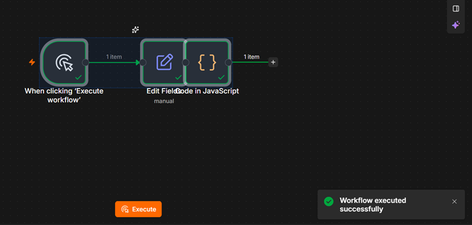
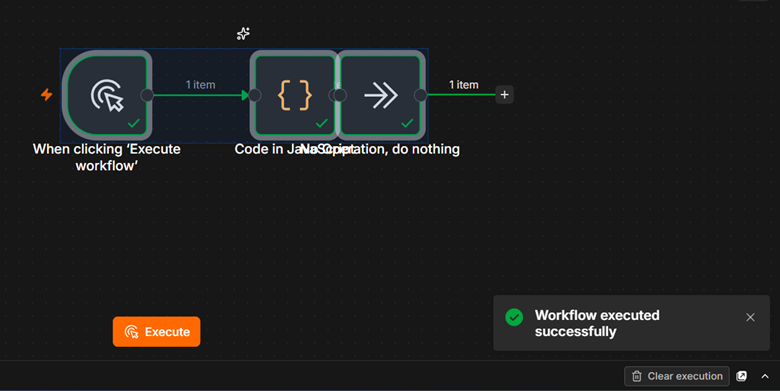
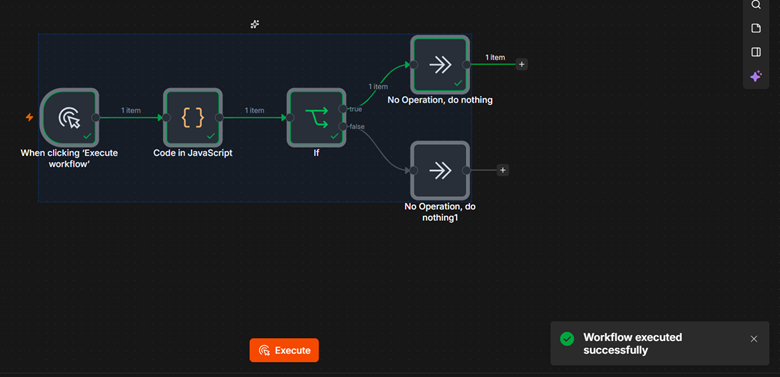
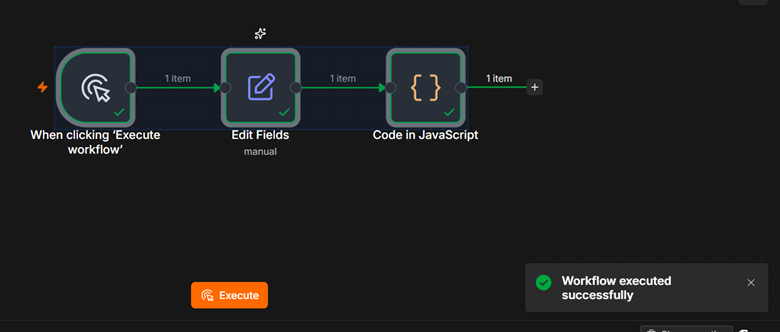
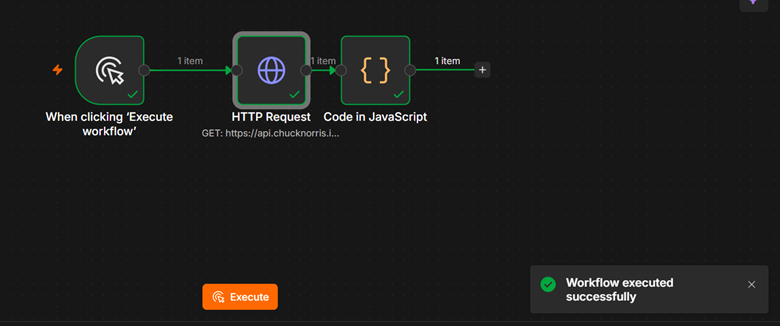
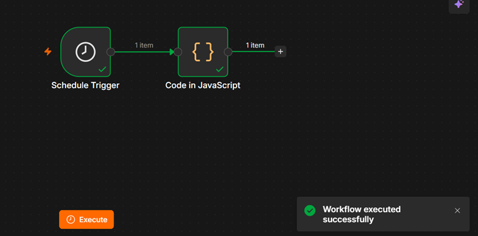
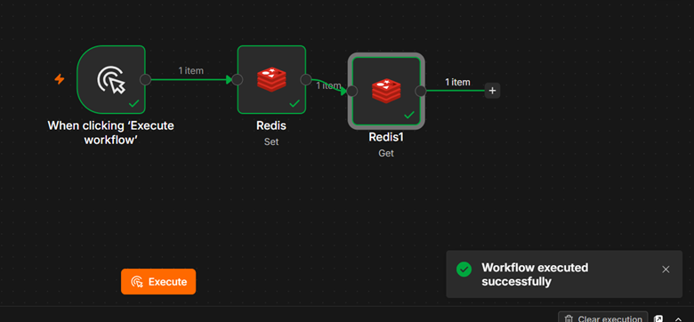
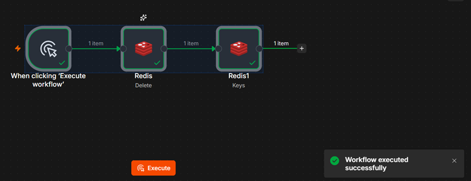
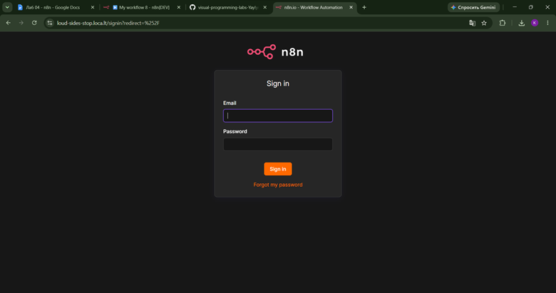

# Отчет по лабораторной работе №4: n8n

## 1. Краткое описание выполненного
В ходе лабораторной работы была успешно развернута платформа автоматизации n8n (через npm). Были изучены базовые принципы построения workflow, работа с триггерами, выполнение кастомного JavaScript-кода и отправка HTTP-запросов. Также была настроена локальная база данных Redis и реализованы операции создания, чтения и удаления ключей.

## 2. Индивидуальная ачивка
**Ачивка 4.3 (Localtunnel)**: Выполнено туннелирование локального порта 5678 в публичную сеть с помощью утилиты `localtunnel`. Получен временный публичный URL для доступа к локальному инстансу n8n из интернета (Скриншот 11).

## 3. Освоенные ноды
- `When clicking 'Execute workflow'` (Manual Trigger) — ручной запуск цепочки.
- `Schedule Trigger` — запуск по расписанию (cron/интервалы).
- `Edit Fields (Set)` — создание и изменение параметров объекта JSON (строки, формулы).
- `Code` — выполнение JavaScript для трансформации данных.
- `If` — ветвление логики на основе условий.
- `HTTP Request` — выполнение GET-запросов к сторонним API (JSONPlaceholder, Chuck Norris API).
- `Redis` — подключение к in-memory базе данных, операции Set, Get, Delete.
- `NoOp` — нода-заглушка.

## 4. Скриншоты workflow
- 
- 
- 
- 
- 
- 
- 
- 
- 

## 5. Выводы
Платформа n8n показала себя как мощный и гибкий инструмент для визуального программирования. Главное отличие от классического кода — данные между узлами передаются в виде стандартизированных JSON-объектов (`Items`), что позволяет легко связывать разнородные сервисы (например, API и базы данных). Возможность писать кастомный код внутри ноды `Code` полностью снимает ограничения low-code подхода, позволяя реализовывать любую сложную логику.