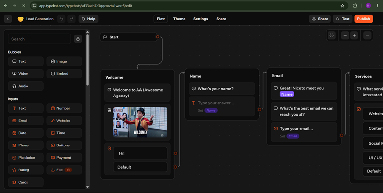
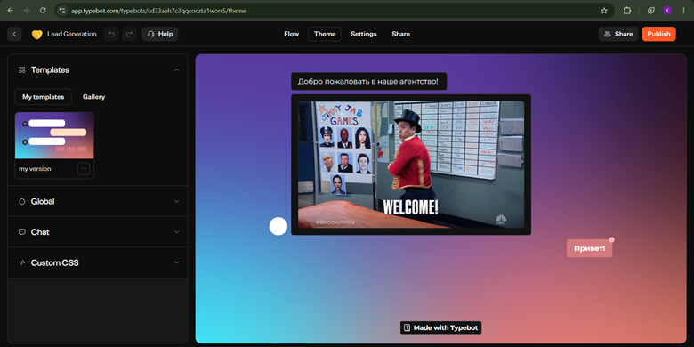
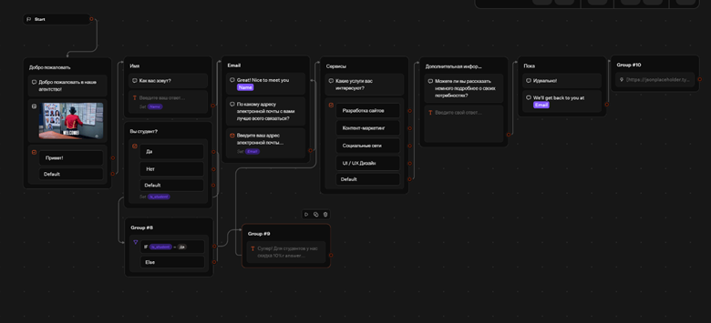

# Отчет по лабораторной работе №5: Чат-боты

## 1. Выбранный трек и описание
**Трек C. TypeBot.** 
Для выполнения работы был выбран базовый шаблон Lead Generation (Сбор лидов). Шаблон был полностью русифицирован (переведены тексты сообщений, кнопки, плейсхолдеры). Изменена визуальная тема оформления. В сценарий добавлены новые блоки: запрос статуса студента, сохранение ответа в переменную `is_student`, логическое ветвление (Condition) для выдачи скидки и интеграция (Webhook) для отправки данных.

## 2. Ссылка на опубликованного бота
👉 **[https://typebot.co/lead-generation-a1worr5]**

## 3. Использованные AI-промпты
- Запрос на поиск нужной панели настроек (Settings) для сохранения ответа пользователя в переменную в интерфейсе TypeBot.
- Помощь в исправлении ошибки с блоком `Listen for webhook` (замена на `HTTP Request` для отправки POST-запроса).
- Генерация корректной структуры логического дерева с использованием блока `Condition`.

## 4. Освоенные блоки и элементы (TypeBot)
- **Bubbles (Text, Image):** Вывод сообщений и медиа-контента.
- **Inputs (Text, Email, Buttons):** Сбор данных от пользователя и предоставление вариантов ответа.
- **Variables:** Сохранение пользовательского ввода (`Name`, `Email`, `is_student`) для дальнейшего использования.
- **Logic (Condition):** Ветвление сценария на основе значения переменной (`is_student = Да`).
- **Integrations (HTTP Request):** Отправка собранных данных на сторонний сервер методом POST.

## 5. Скриншоты
- 
- 
- 

## 6. Выводы
В ходе выполнения работы я освоил платформу TypeBot. Платформа представляет собой удобный визуальный конструктор, позволяющий создавать сложных ботов без написания кода. Главным итогом стало понимание того, как собирать данные от пользователя в переменные и настраивать на их основе логику работы (через Condition), а также как передавать собранную информацию во внешние системы с помощью Webhook (HTTP-запросов).